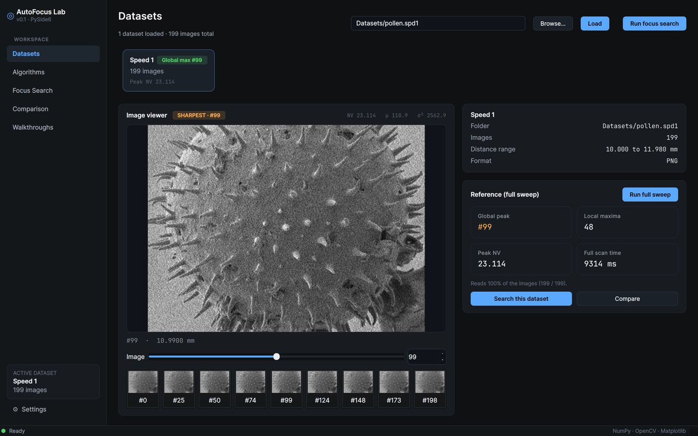
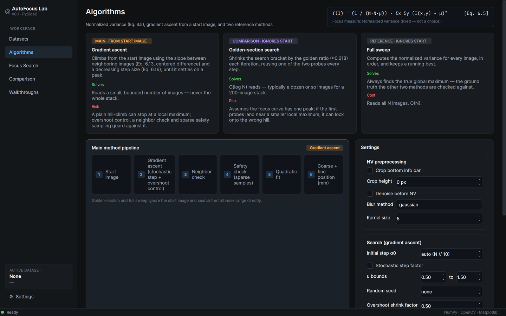
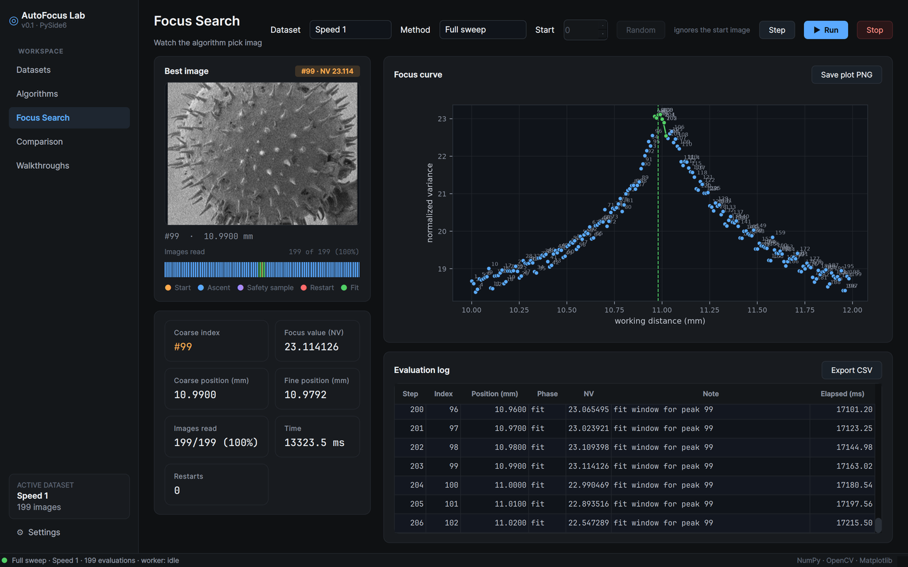
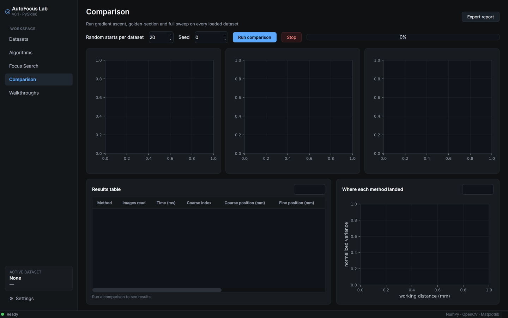
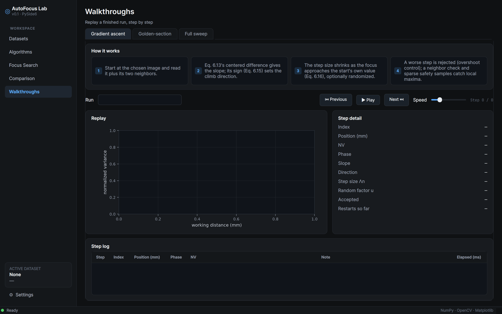

# AutoFocus Lab

Static-autofocus algorithms for the SEM pollen-grain image stacks
(Computer Vision lab), plus a PySide6 desktop GUI built on top of them.

- **`autofocus/`** — the algorithm package (section below): normalized
  variance, gradient ascent, golden-section, full sweep, quadratic fit.
  No GUI code, no `print`, no plotting.
- **`app/`** — the PySide6 GUI (see [GUI section](#gui-autofocus-lab-app)
  below). Imports `autofocus`; never reimplements it.

## What's here (`autofocus/`)

| Module | Contents |
|---|---|
| `settings.py` | `AutofocusSettings` — every tunable parameter, in one dataclass. |
| `dataset.py` | `ImageDataset` — lists + naturally sorts image files, maps index <-> working distance (mm). Reads no pixels. |
| `focus.py` | `normalized_variance` (Eq. 6.5), preprocessing (crop/denoise), `FocusEvaluator` — lazy, cached, counted, traced image reads. |
| `search.py` | `gradient_ascent` (6.3.2), `golden_section` (6.3.1), `full_sweep` (baseline). |
| `fit.py` | `quadratic_fine_position` — sub-index peak via a parabola fit (Eq. 6.10). |
| `results.py` | `AutofocusResult`, `TraceStep` — plain data returned to the caller. |
| `__main__.py` | Tiny CLI for manual testing (no GUI). |

## Running

```bash
python -m pip install -r requirements.txt
python -m pytest tests/
python -m autofocus Datasets/pollen.spd1 --start 25 --method gradient --seed 0
python -m autofocus Datasets/pollen.spd1 --method golden
python -m autofocus Datasets/pollen.spd1 --method sweep
python experiments/make_report_figures.py Datasets --out results/
```

Note on this lab's dataset layout: `Datasets/pollen.spd1/*.png` holds its
images directly, but `pollen.spd2`, `pollen.spd3` and `pollen.spd5` each
nest their images one level deeper, in `Datasets/pollen.spdN/pollen.spdN/`.
The CLI (`__main__.py`) takes the exact image folder, so for those three
point it at the nested folder, e.g. `Datasets/pollen.spd2/pollen.spd2`.
`experiments/make_report_figures.py` auto-detects both layouts, so pointing
it at `Datasets/` directly works for all four speeds.

## Design notes

- **Lazy access.** `ImageDataset` only lists and naturally sorts file names
  on open. `FocusEvaluator.evaluate(index, ...)` is the only thing that
  decodes an image, and only the first time a given index is requested —
  later calls return the cached normalized-variance value. Every call
  (cache hit or miss) is appended to a trace and forwarded to an optional
  `on_step` callback, so a GUI can draw points live without changing the
  algorithm.
- **One evaluator per search call.** `gradient_ascent`, `golden_section`
  and `full_sweep` each create their own `FocusEvaluator`, so
  `images_read` / `percent_read` in the returned `AutofocusResult` reflect
  exactly what that one search (coarse + fine fit) read.
- **Cancellation.** All three searches accept `should_stop()`; it is
  polled inside every loop and, if it returns `True`, the search returns
  a partial `AutofocusResult` with a warning instead of raising.

## Parameters (`AutofocusSettings`)

| Parameter | Default | Meaning |
|---|---|---|
| `d_min_mm` | `10.0` | Working distance of image index 0 (mm). |
| `step_mm` | `0.010` | Working-distance increment per index (mm). `d(i) = d_min_mm + i*step_mm`. |
| `do_crop_bottom` | `False` | Remove the SEM info bar before computing focus. |
| `crop_bottom_px` | `0` | Rows removed from the bottom. See "Crop assumption" below. |
| `do_denoise` | `False` | Blur before computing focus. |
| `denoise_method` | `"gaussian"` | `"gaussian"` or `"median"`. |
| `denoise_ksize` | `5` | Blur kernel size (forced odd). |
| `delta` | `1` | Centered-difference step, Eq. 6.13. |
| `alpha0` | `None` | Initial step gain, Eq. 6.16; `None` => `max(2, N // 10)`. |
| `use_stochastic_factor` | `False` | Multiply the step by `u ~ U(low, high)`. |
| `stochastic_low` / `stochastic_high` | `0.5` / `1.5` | Bounds of `u`. |
| `use_overshoot_control` | `True` | Reject a worse step; shrink alpha instead. |
| `overshoot_shrink` | `0.5` | Alpha shrink factor after a rejected step. |
| `max_iterations` | `100` | Cap on climbing steps per ascent run. |
| `use_neighbor_check` | `True` | After convergence, keep climbing if a direct neighbor is better. |
| `use_safety_check` | `True` | Sample `safety_samples_k` evenly spaced images; restart if one beats the found peak. |
| `safety_samples_k` | `8` | Number of safety-check samples (incl. both ends). |
| `max_restarts` | `3` | Max safety-check restarts. |
| `fit_half_window` | `3` | Half-width (images) of the quadratic-fit window, Eq. 6.10. |
| `seed` | `None` | Seed of the `numpy.random.Generator` used for the stochastic factor. |

## Crop assumption

`crop_bottom_px` defaults to `0` (`do_crop_bottom=False`). A sample image
from `Datasets/pollen.spd1` (768x1024) was inspected row by row down to the
very last row and shows pollen-grain content all the way to the bottom —
no solid info bar is visible in this dataset, so it looks like it was
already cropped upstream before being handed out for the lab. The
preprocessing flag is implemented and works (set `do_crop_bottom=True` and
`crop_bottom_px` to the bar height in pixels if a differently-prepared
dataset does have one), it is just off by default here.

## Observed working-distance step

Each speed folder ships a `*.WDs.yml` with the working distances actually
used by the microscope for that acquisition; for `pollen.spd1` these run
`10.260, 10.265, 10.270, ...` mm, i.e. a `0.005` mm step starting at
`10.26` mm, not the lab's generic default (`d_min_mm=10.0`,
`step_mm=0.010`). The package does not read these `.yml` files — position
is always computed from the formula in section 1 — but `d_min_mm` /
`step_mm` are both `AutofocusSettings` fields, so they can be set to match
a particular dataset's real values when that matters (e.g. for the report
figures).

---

## GUI (`app/`, "AutoFocus Lab")

A PySide6 desktop app built on top of `autofocus` — it imports and calls
`AutofocusSettings`, `ImageDataset`, `FocusEvaluator`, `gradient_ascent`,
`golden_section`, `full_sweep` and `quadratic_fine_position`; it does not
reimplement or alter any formula.

### Running

```bash
python -m pip install -r requirements.txt
python -m app          # or: python main.py
```

Point the Datasets page at `Datasets/` (the root folder with the 4 speed
sub-folders) or at one dataset folder directly.

### Screens

| Screen | What it does |
|---|---|
| **Datasets** | Load a dataset folder (or a root with speed sub-folders, shown as cards). Loading only lists files. An image slider previews images (decoded directly, bypassing the focus evaluator, so browsing never counts as an evaluation). "Run full sweep" is opt-in and shows the global peak, local-maxima count, peak NV and scan time only after it finishes. |
| **Algorithms** | The Eq. 6.5 formula; cards for the 3 methods (how it works / solves / risk); the main method's pipeline (start → gradient ascent → neighbor check → safety check → quadratic fit → coarse+fine position); the settings form (3 groups, 1:1 with `AutofocusSettings`), shared by every other screen. |
| **Focus Search** (main) | Pick a dataset, method and start image; Run / Step / Stop. Shows the live best image, a per-image evaluation strip (colored by phase), result stat cards (coarse/fine index and position, real NV, images read, time, restarts), the live focus curve (points colored and numbered by phase, parabola + fine-position line once fit, grey dashed full-sweep reference if available) and a full evaluation log with CSV/PNG export. |
| **Comparison** | Runs full sweep + golden-section + N random-start gradient ascents (fixed seed) on every loaded dataset in the background. Bar charts (images read, time, success rate), a per-dataset results table, a "where each method landed" plot, and a CSV+PNG report export. |
| **Walkthroughs** | Replays a *finished* run step by step (Play/Pause/Next/Previous + speed), one tab per method. The gradient-ascent tab additionally shows slope, direction, step size Λn, random factor and accepted/rejected per step (parsed from the enriched trace notes — see "Changes to `autofocus/search.py`" below). |

### Screenshots

| Datasets | Algorithms |
|---|---|
|  |  |

| Focus Search | Comparison |
|---|---|
|  |  |

| Walkthroughs |
|---|
|  |

### Threading

Every search runs in a background `QThread` (`app/workers.py`). The
`on_step` / `should_stop` callbacks the package already exposes are wired
straight to Qt signals and a `threading.Event`; the GUI thread never calls
an `autofocus` search function directly, so the window never freezes.

### Bundled fonts

`app/fonts/` ships Inter (SIL OFL 1.1) and JetBrains Mono (Apache 2.0),
loaded via `QFontDatabase.addApplicationFont()` in `app/__main__.py`
before the stylesheet is applied. Without this, `theme.qss`'s font-family
lists fall back to whatever generic sans/mono fontconfig resolves to on
the machine running the app — visibly different from (and worse than) the
design's actual typography. Bundling the exact font files makes the look
reproducible on any machine, not just ones that happen to have Inter
installed.

### Plotting library

**Matplotlib** (`matplotlib.backends.backend_qtagg`), not pyqtgraph. The
plots here update once per evaluation (at most a few hundred points per
run) rather than per animation frame, and matplotlib is already a project
dependency for `experiments/make_report_figures.py` — pyqtgraph's extra
dependency and API surface wouldn't buy anything at this update rate.

### Thin adapters added in the GUI (not in `autofocus/`)

The package has no notion of these; both are implemented entirely in
`app/`, without changing what any search computes:

- **Single-step execution** (`app/workers.py: SearchWorker`). The package's
  search functions run to completion in one call. In single-step mode, the
  *existing* `on_step` callback blocks the worker thread on a
  `threading.Event` after every evaluation until the GUI calls `advance()`.
- **Local-maxima count** and **where-each-method-landed** scatter
  (`app/pages/datasets.py`, `app/pages/comparison.py`) are pure display
  computations over an already-finished `AutofocusResult` — no new focus
  values are computed.

### Changes to `autofocus/search.py`

One cosmetic change, made with explicit sign-off: the gradient-ascent
loop's `TraceStep.note` text was enriched with `key=value` fields
(`slope`, `dir`, `lam`, `u`, `step`, `accepted`) at the points in `_climb`
where those values are already computed, plus a `restart #N` marker on
restart-start notes. No formula, control flow, or return value changed —
confirmed by the full `tests/` suite passing unchanged before and after.
This is what lets the Walkthroughs page show per-step slope / direction /
step size / random factor / accepted-or-rejected without `autofocus`
exposing any new API. `app/pages/walkthroughs.py: parse_note_kv()` is the
GUI-side parser for this plain-text format.

### Known gaps / things a reviewer should know

- **Per-step elapsed time** isn't tracked by the package (only the total
  `AutofocusResult.elapsed_s`). The Focus Search log's "Elapsed (ms)"
  column is timestamped on arrival of each `on_step` signal relative to
  when the GUI started the run — a reasonable proxy, not a value from
  `autofocus` itself. Walkthrough replays (which have no live timing to
  observe) show `0.00` in that column.
- **`use_overshoot_control`** is not exposed in the settings form — the
  spec's Algorithms page lists `shrink factor` under Search but not an
  overshoot on/off toggle, and the pipeline card presents "gradient ascent
  (stochastic step + overshoot control)" as fixed. It stays `True`
  (the package default) for every run started from the GUI.
- **`d_min_mm` / `step_mm`** are not exposed in the settings form either
  (kept at the package defaults, `10.0` / `0.010`) — the spec ties the
  Datasets page's distance-range display to those exact defaults and lists
  only 3 settings groups (preprocessing, search, fine position) for the
  form.
